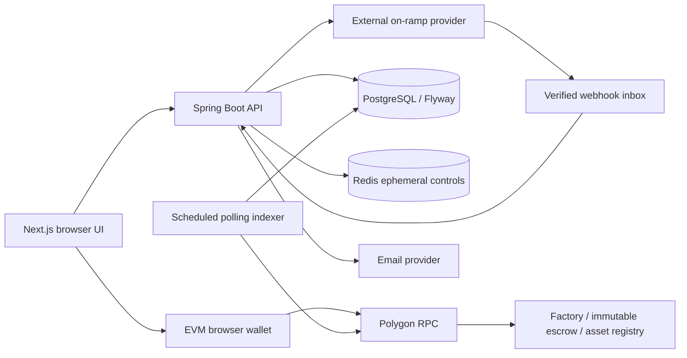

# Actual architecture

## Runtime boundaries

Render builds the Java backend Dockerfile and the Next.js application. There is
also an older TypeScript/Express/Prisma backend under `backend/src/*.ts` and
`backend/prisma`; it is not the authoritative deployed backend. No architecture
migration is justified merely by its presence.

The API owns user/project membership, project-manager invitations, deliverable
review, intent creation, audit, provider inbox, and durable projections. Wallets
sign and submit transaction intents. The backend does not sign escrow payments.
Contracts independently enforce parties, acceptance, funding, milestone states,
disputes, release and refund. Backend approval is distinct from buyer on-chain
approval. An off-chain dispute is not an on-chain freeze until a wallet confirms
the dispute transaction.

`ChainIndexer` polls RPC receipts and bounded log ranges, validates canonical block
hashes, then commits events/projections under database locks. RPC failure or a
reorg must block financial eligibility rather than create success. Database
transactions cannot atomically include a provider request or wallet transaction;
durable intents and reconciliation bridge that boundary.

The configured payment rail defaults to BLOCKCHAIN. Historical Razorpay code is
retained behind its rail policy; local ledger release is not proof of a vendor
bank payout. Onramper buys assets into a verified user wallet, which subsequently
funds escrow. FinX is not a fiat converter, bank, KYC provider or legal custodian
merely because these integrations exist. Off-ramp is unconfigured/simulated code,
not a demonstrated production bank settlement integration.

## Data and administration

Fiat values use explicit currency and NUMERIC(15,2); token values use
NUMERIC(78,0), serialized as strings to avoid JavaScript precision loss. Fiat and
token allocations are separate; there is no implicit INR/USDC exchange rate.
Redis is not a financial source of truth.

Project access is initially user-based (buyer, seller and assigned PM), with
global platform administrators and finance access that needs restriction.
Organizations and organization membership are not implemented at baseline.
Migration of existing records into organizations requires verified ownership
mapping and cannot be guessed from email addresses or display names.

Registry/factory governance, dispute council and pause council are distinct
contract addresses. The bundled TestnetCouncil is single-owner test tooling,
not production multisig. No upgradeable proxy, hidden emergency withdrawal or
platform-controlled vendor payout address was found in the escrow contracts.

## Risks requiring measured refactoring

Finance aggregation lives in controllers; list APIs are largely unbounded.
Services mix JPA and JDBC, so lock order and stale managed entities need care.
Polling is restartable but RPC/network availability remains external. Local
tests cannot prove production PostgreSQL isolation, alert delivery, horizontal
capacity, backup restoration or provider reconciliation.
