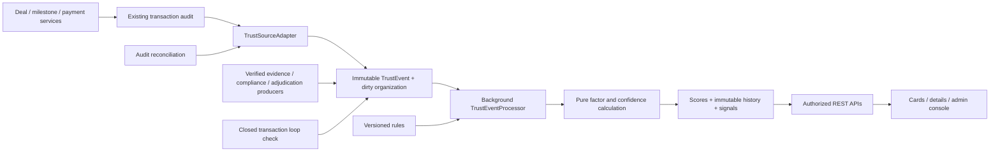

# FinX Trust Engine (TRUST_V1)

This implementation adds persisted, explainable organization, buyer and vendor reliability scores. It does not control payment execution. Existing authentication and transaction ownership remain in place.

## Architecture



The actual repository had no Organization entity, structured dispute verdict, invoice verification service, or legal-entity membership model. V14 introduces organizations and explicit membership. Existing BUYER/SELLER accounts receive singleton organizations with their existing UUID as a migration bridge. That identity is not a KYB assertion. Future membership consolidation needs a separately audited identity-migration workflow; do not merge on company names or email domains.

New accounts are provisioned by the background worker, the first trust lookup, or their first eligible transaction event. Deal ownership still refers to users. Trust event attribution resolves their explicit organization memberships. An organization can hold both buyer and vendor histories through multiple members.

`AuditService` publishes a small in-process notification in its existing transaction. The adapter snapshots eligible facts into `trust_events` and marks the organization dirty **in that same transaction**. A rollback removes both the domain operation and its trust facts. The listener performs no score calculation and no external calls. The database is the durable work queue; no broker is required.

The worker starts after 30 seconds and polls every 15 seconds. It provisions up to 100 accounts, reconciles up to 100 historical audit records, then processes up to 50 eligible organizations. A pessimistic organization lock serializes ingestion and calculation across application instances. Multi-party source writers lock organizations in UUID order. Failed calculations retain pending work and back off for five minutes. Admin organization results expose `dirty`, `failures` and `retryAfter`.

The worker also recalculates inactive accounts after 24 hours for time decay and recalculates stale configuration versions. GET score requests read stored results; they never replay transaction history. The fallback for an uncalculated account is an explicit neutral/insufficient response with no calculation timestamp.

## Scoring and confidence

Each configured event rule supplies a factor, outcome score, evidence weight and explanation. For each factor:

```text
factorScore = (50 × priorWeight + Σ(outcomeScore × effectiveWeight))
              / (priorWeight + Σ effectiveWeight)
effectiveWeight = configuredEventWeight × timeDecay × severityForNegativeEvents
overallScore = Σ(factorScore × configuredRoleWeight)
```

The neutral prior is 2 observations. All results are bounded to 0–100. Missing evidence stays neutral. Weights are centralized in immutable `trust_scoring_config` versions, seeded by V15.

| Factor | Overall | Buyer | Vendor |
|---|---:|---:|---:|
| Payment | 25% | 40% | 0% |
| Milestones / approvals | 20% | 10% | 35% |
| Disputes | 15% | 15% | 15% |
| Contract compliance | 15% | 15% | 15% |
| Evidence | 10% | 5% | 20% |
| Transaction history | 10% | 10% | 10% |
| Network | 5% | 5% | 5% |

The supplied overall weights are preserved exactly. Vendor scoring avoids treating lack of buyer payments as poor vendor behaviour. Network and history weights cannot exceed 5% and 10%. Config validation requires complete role matrices summing to 1, sensible thresholds, finite numbers, declining decay multipliers, and rules that retain their factor and positive/negative interpretation. Model changes require a new algorithm version in code; administrators cannot label a different algorithm TRUST_V1.

Default decay is 100%, 80%, 60%, 30%, 10% for ages 0–90, 91–180, 181–365, 366–730 and over 730 days. Confirmed fraud and severe breaches retain at least 60% of their evidence weight. Confirmed organizational fraud caps all roles at 20, including accounts without sufficient positive history. No account or transaction is automatically blocked.

Thresholds are 90 HIGHLY_TRUSTED, 75 TRUSTED, 60 MODERATE, 40 ELEVATED_RISK, otherwise HIGH_RISK. Eligibility requires at least 3 qualified completed deals **or** 10 qualified behaviour units, **and** at least 2 counterparties. Until then, the published score is neutral 50 with INSUFFICIENT_DATA; the UI hides the numeric score. Verified fraud remains visible as HIGH_RISK.

Confidence is separate and configurable:

| Supporting history | Maximum points | Full support at |
|---|---:|---:|
| Qualified completed deals | 30 | 20 |
| Accepted milestone units | 25 | 50 |
| Distinct meaningful counterparties | 20 | 10 |
| Account age | 10 | 365 days |
| Accepted observations | 15 | 100 |

Each metric grows linearly to its cap. Confidence never changes reliability weights. Counters used for confidence respect qualification and diversity limits; raw uploaded-file counts cannot establish trust.

## Manipulation controls and fairness

- Duplicate delivery uses a unique `(organization, producer, sourceKey)` identity. Event insertion and pending state are atomic; concurrent duplicates serialize on the organization lock.
- Related events collapse to one observation per factor and economic unit (milestone or deal). Multiple documents and retries do not mint positive evidence. An adverse observation is retained with its actual decay.
- Positive evidence requires a recorded deal, another organization, a known currency, and minimum value (INR 1,000; USD/USDC 10). Unknown currencies do not gain positive credit until configured; no invented FX rates are used.
- Positive evidence is capped at 3 units per deal and 10 per counterparty for each factor. The newest positive evidence is considered first. Self-dealing does not create positive credit.
- A completed contract contributes observed compliance and dispute exposure. A completed transaction is not described as a dispute win. Actual lost disputes carry substantially stronger negative evidence.
- Open or neutrally resolved disputes do not imply fault. The adapter never infers a winner from free-text resolution notes or a refund destination.
- High concentration, unusually rapid completions and daily bursts create understandable review indicators. Rejected/repeated revisions remain visible rather than being erased by resubmission.
- A bounded query detects completed two- or three-edge transaction loops and self-dealing through explicit memberships. These are supporting review signals, not fraud verdicts or guilt by association.

## Integration contracts

`TrustEventInput` and `TrustEventIngestionService.record` are internal Java contracts. No HTTP endpoint lets buyers, vendors, or administrators write arbitrary scoring events.

Approved producer names are FINX_AUDIT, EVIDENCE_VERIFIER, COMPLIANCE_ENGINE, COUNTERPARTY_GRAPH and VERIFIED_ADJUDICATION. Future producers must run behind their own verified authorization boundary. Producer names are an internal contract, not authentication for an external message bus.

Ingestion validates organization membership, deal parties and roles, milestone ownership, counterparty attribution, currency and deal-value bounds. Metadata is a small allowlist of scalar fields: `deadlineKnown`, `delayDays`, `disputeId`, `elapsedSeconds`, `evidenceReference`. It cannot contain arbitrary nested documents, file contents or secret material. Confirmed fraud, loss/win adjudications, breaches and unfair-rejection findings require a nonblank verified evidence reference and an adjudication/compliance producer.

Current source mappings:

| Existing source | Recorded facts |
|---|---|
| PAYMENT_VERIFIED / PAYMENT_FAILED | Payment completed / failed, attributed to buyer |
| DELIVERABLE_SUBMITTED | Submission and upload; lateness only when the agreed deadline was captured |
| MILESTONE_APPROVED | Vendor delivery and accepted evidence; buyer/assigned-PM approval behaviour |
| MILESTONE_REJECTED | Vendor revision/rejection evidence |
| Escrow release / confirmed on-chain release | Milestone completed |
| DEAL_COMPLETED / DEAL_CANCELLED | Both parties' completion/cancellation history |
| DISPUTE_CREATED / DISPUTE_RESOLVED | Neutral dispute context for both parties |
| Confirmed on-chain ESCROW_FUNDED | Buyer payment completion |

Historical audit replay is idempotent. Old submission audits did not snapshot the agreed deadline, so replay does not claim they were on time or late. Unrecorded historical payment failures, invoice checks or adjudications are never invented.

## Schema and auditability

V14 is additive; it does not alter existing transaction tables. V15 seeds the configuration and adds PostgreSQL integrity triggers.

| Table | Purpose |
|---|---|
| organizations | Identity bridge, creation age, serialized dirty/retry/config state |
| organization_members | Explicit user-to-organization relationship |
| trust_events | Immutable event facts, JSONB metadata, producer key; processed can move only false → true |
| trust_scores | One persisted result per organization and role; components/statistics in typed JSONB |
| trust_score_history | Immutable before/after score and level, actor, reason, trigger, config version and complete result snapshot |
| trust_scoring_config | Immutable rules, change reason, administrator and creation time |
| trust_signal | Immutable aggregate signal snapshots attached to each calculation |
| trust_manual_review | Review reason, creator, status and resolution; actions also use existing AuditLog |
| trust_audit_receipts | Durable source reconciliation receipts |

Components are embedded in `trust_scores.result` and history snapshots, rather than duplicated across a second mutable components table. `trust_signal.impact` is a polarity marker (+1/-1); the actual quantitative factor contribution is represented by the snapshot's factor score and weight.

Every result stores TRUST_V1, configuration version, exact calculation time, counts, factors and a SHA-256 digest of ordered input event IDs. Replay must use the retained configuration and events with both `occurredAt` and `createdAt` at or before the snapshot time, ordered by `occurredAt,id` and filtered for the role. Critical facts and configuration/history/signal rows reject UPDATE, DELETE and TRUNCATE at the PostgreSQL layer. Only the event processing marker can advance. Do not modify historical TRUST_V1 semantics when implementing V2.

Indexes cover organization/time event replay, event type/time, pending events (including a PostgreSQL partial index), score level, organization/role/time history, membership, review queues and source idempotency. JSONB parameters are bound through Hibernate; no metadata is interpolated into SQL.

Admin recalculation requires a reason and allows one request per organization every 60 seconds, enforced under the database lock. Configuration writes require the expected version and retain previous versions. Reviews do not modify scores. There is no direct score-adjustment endpoint.

## APIs

Responses use the existing `{success, message, data, timestamp}` envelope. Existing JWT authentication and `/api/admin/**` RBAC apply. Trust details are limited to organization members and admins; unrelated organizations and project-scoped staff cannot read private organization histories by guessing an ID.

| Method | Path | Purpose |
|---|---|---|
| GET | /api/trust/mine | Resolve/provision the current eligible account's organization |
| GET | /api/trust/{id} | Overall persisted score |
| GET | /api/trust/{id}/breakdown | Overall factors and explanations |
| GET | /api/trust/{id}/buyer-score | Buyer result |
| GET | /api/trust/{id}/vendor-score | Vendor result |
| GET | /api/trust/{id}/signals?role=OVERALL | Current positive/negative explanations |
| GET | /api/trust/{id}/history?days=90&role=OVERALL | Last calculation per UTC day; days 30, 90 or 180 |
| GET | /api/admin/trust/organizations?query=&page=0 | Search organization names; 50 per page |
| POST | /api/admin/trust/{id}/recalculate | Recalculate; body `{ "reason": "...at least 10 characters..." }` |
| GET | /api/admin/trust/{id}/events?page=0 | Admin event inspection; 50 per page |
| GET | /api/admin/trust/calculations/{historyId} | Complete immutable calculation snapshot |
| GET | /api/admin/trust/config | Current configuration |
| PUT | /api/admin/trust/config | `{ "rules": { ... }, "expectedVersion": 1, "reason": "..." }` |
| GET | /api/admin/trust/reviews?status=OPEN&page=0 | Review queue (OPEN or RESOLVED) |
| POST | /api/admin/trust/{id}/reviews | Create review with reason |
| POST | /api/admin/trust/reviews/{reviewId}/resolve | Resolve review with reason |

The running backend's existing `/swagger-ui.html` exposes the DTOs and request schemas. Typical errors: 400 invalid configuration/parameters, 401 missing authentication, 403 unauthorized organization/admin access, 404 unknown resource, 429 recalculation cooldown.

## UI

- `TrustScoreCard`: server-supplied reliability, confidence, explanation, strengths, risks, history change and last update. No client-side scoring.
- Buyer/vendor overview cards and `/trust`: organization lookup with loading, failure and retry handling.
- `/organizations/[id]/trust`: overall/buyer/vendor views, weighted factors, 30/90/180-day SVG graph, accessible history table, signals and activity/counterparty counts. Private counterparty identities/documents are excluded.
- `/admin/trust-engine`: search, factor/history views, event inspection, calculation snapshots, recalculate with reason, review creation/resolution and configuration version editor.

The repository uses Tailwind and its own components; Ant Design was not installed, so this feature introduces no additional UI library.

## Run and verify

Use Java 21 or a newer JDK compiling to release 21. Spring Boot 3.4 cannot scan Java 25 class files reliably; the project target now matches the requested Java 21. The Windows Maven wrapper's null symlink-target handling was repaired.

```powershell
cd backend
.\mvnw.cmd clean test -Djava.version=21 -Dmaven.compiler.release=21
.\mvnw.cmd spring-boot:run -Dspring-boot.run.profiles=local
```

The local profile applies Flyway to its local database. Production should use its configured PostgreSQL datasource and Flyway migrations. This work has not deployed or migrated a production database.

```powershell
cd frontend
npm.cmd run lint
npm.cmd run build
npm.cmd run dev
```

Production build requires access to the application's existing Google Fonts dependency. The feature itself has no external API dependency.

For real PostgreSQL tests, use a disposable **localhost-only** PostgreSQL test server with trust authentication and no production data:

```powershell
$env:FINX_TRUST_TEST_POSTGRES_URL='jdbc:postgresql://127.0.0.1:55439/postgres'
$env:FINX_TRUST_TEST_POSTGRES_USER='finx_trust_test'
cd backend
.\mvnw.cmd clean test -Djava.version=21 -Dmaven.compiler.release=21
```

Those tests create randomly named schemas and drop only those schemas afterward. They are skipped when the explicit local URL is absent. The PostgreSQL tests verify the real application APIs as well as migration replay, JSONB, uniqueness, indexes, and immutable-history triggers. H2 alone is not considered evidence for PostgreSQL trigger correctness.

Worker switches: `TRUST_WORKER_ENABLED` (true), `TRUST_WORKER_DELAY_MS` (15000), `TRUST_WORKER_INITIAL_DELAY_MS` (30000). Configuration changes are managed through the versioned admin API, not environment variables.

## Limits and rollout

1. Account-backed singleton organizations are a compatibility bridge. Legal-entity onboarding, shared ownership and membership changes need a dedicated audited workflow before consolidating existing companies.
2. Existing payments have no deposit deadline, and approvals have no agreed review SLA. Completion is measured; unrecorded lateness or unfairness is not inferred. New deadline/adjudication producers can use the internal event contract.
3. Accepted deliverables are current evidence-quality observations. Content hashes, invoice extraction, forgery checks, sanctions/KYB verification and coordinated identity detection require their future verification services. Merely supporting their event types does not implement those services.
4. Dispute losses/wins and fraud must come from verified structured adjudication. Free-text resolutions remain neutral. Appeals/corrections need a separately designed append-only supersession workflow; manual reviews currently document decisions without altering facts.
5. The graph heuristic detects simple completed loops, concentration, self-dealing and bursts. It is not a general graph fraud model, and counterparties' reputation alone never blocks an account.
6. Pages read persisted scores, but V1 background calculation replays each organization's history. It is indexed and streamed, with storage proportional to distinct economic units. Before very large per-organization histories, add daily feature aggregates, partitioning, retention policies, queue telemetry and load testing. No million-event throughput claim is made.
7. Chain events follow the existing confirmed indexer. A future reorg/correction producer should supersede trust observations if previously confirmed chain history is invalidated; this module does not implement a new chain-finality policy.
8. Signals are aggregate explanations; complete facts remain in the admin event API and immutable input history. Account creation age is not proof of reliability.

Recommended next phase: run in shadow mode, calibrate the rule weights against reviewed outcomes, establish legal-entity identity and appeal procedures, then integrate verified evidence/adjudication/deadline producers and incremental feature aggregation. Retain the API and factor interface when adding future models. No ML is introduced here.
