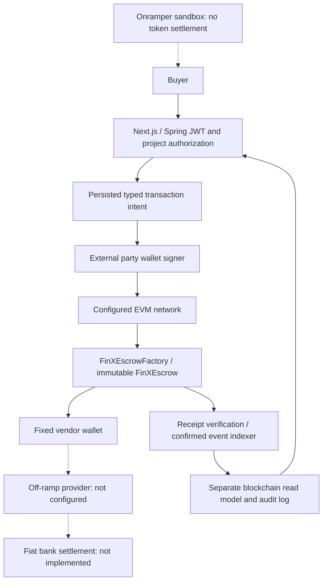

# Blockchain architecture

Spring Boot is the authoritative application API; EVM contracts are authoritative for token custody. The disabled Node backend is not part of this migration.

## Payment rails

`PaymentRailPolicy` selects `BLOCKCHAIN` (default) or `RAZORPAY`. BlockchainEscrowRail owns typed intents, frozen schedules, verified wallets and funding intents. The preserved PaymentService/EscrowService own the legacy Razorpay flow. Their mutating entry points reject blockchain mode before calling Razorpay or moving fiat ledger balances. History remains readable.

## Trust boundaries

- A deal remains an INR commercial agreement. Buyer proposes separate exact token amounts for all milestones. Vendor and buyer separately accept the deployed immutable token schedule. No implicit exchange rate is applied.
- A factory creator operator deploys the contract. CREATOR_ROLE does not control token releases. Buyer signs approvals; either party can execute an approved release; vendor can voluntarily refund; only the configured contract council can arbitrate.
- The browser TransactionSigner interface separates construction from signing. BrowserWalletSigner uses EIP-1193; the wallet manages nonce, gas, signing and broadcast. Backend never receives a custody private key. KMS/HSM/MPC adapters are not implemented or claimed.
- Ownership challenges contain user, domain, chain, wallet and a random nonce with five-minute expiry. Verified wallets are immutable in this MVP. Contract-wallet ownership (EIP-1271) and wallet rotation are not implemented.

## Persistence and concurrency

V10 adds blockchain_wallets, blockchain_escrows, blockchain_allocations, blockchain_transactions, blockchain_events and blockchain_funding_intents. JDBC is used for these records alongside existing JPA aggregates. NUMERIC(78,0) stores atomic uint256 values; API numbers are decimal strings. Constraints protect total/funded/released/refunded conservation, unique project escrow, operation identity and chain/hash/log index.

Creation locks the deal; intent creation locks escrow; receipt updates lock transaction; projection locks escrow and compares the old checkpoint. RPC calls in indexing occur before the short projection transaction. Concurrent indexers can read the same range but only one commits a given checkpoint. Repeated HTTP requests return the same operation; changed idempotency payloads reject. Confirmed reverts can create a new attempt while preserving the failed record.

## Chain indexing

ChainGateway checks chain ID, token decimals and factory version. Submitted transactions must match sender, destination, zero native value and exact calldata. Council execution additionally requires the matching escrow DisputeResolved event. Receipts must be canonical and meet confirmation depth.

The indexer validates immutable parties/token/factory/identifiers/amounts against the application schedule, scans bounded 500-block ranges, stores unique events and recomputes finalized accounting from contract state. Both allocation totals and token balance are checked. Direct token donations never count as funding. Restart resumes persisted checkpoints, including events initiated directly through a wallet.

Detected checkpoint reorgs set REORG_REVIEW and prevent new intents. Automatic reversal of finalized financial records is deliberately absent; review/rebuild requires an operator procedure. An RPC outage leaves existing confirmed history intact and does not create success. Reconciliation is not a substitute for independent RPC providers or chain finality monitoring.

## Provider boundary

The existing Onramper signing service now produces Ed25519 V2 sandbox widget URLs, locked to the verified buyer wallet and configured provider asset identifier. Sandbox uses publishable `pk_test_` keys only; no API secret or private signing key is returned. Original unsafe unpersisted session creation is paused in blockchain mode. Funding intents are persisted before checkout. Webhooks store hashes, not KYC payloads, and never settle custody.

OffRampProvider has an unavailable adapter and explicit local simulation. Neither reports bank settlement. No fiat payout is implemented.
